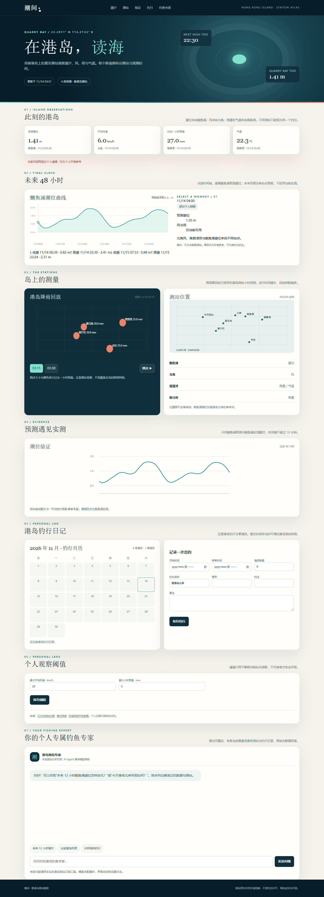

# 潮间 · 香港岛测站环境图册 (ChaoJian: Hong Kong Island Coastal Station Atlas)

[](./LICENSE)
[](https://nodered.org/)
[](https://www.mongodb.com/)

**潮间 (ChaoJian)** 是一个基于 **Node-RED + MongoDB + Agentic Tool-Calling** 构建的香港岛近岸环境与潮汐观测图册系统。它整合了香港天文台（HKO）官方开放数据（鰂鱼涌逐时预测与 5 分钟实测潮位、区域风况、过去一小时雨量、气温、能见度、9 天天气预报、北角参考海温及实时生效天气警告），提供 48 小时实测/预测潮位交互时间轴、Leaflet / 内置双模地图选点分析，以及支持**本地免密钥大模型（Ollama）**的只读工具调用智能问答助手。



---

## 核心特性 (Key Features)

1. **多源官方测站接入与严格时空对齐**
   - 接入香港天文台鰂鱼涌潮位（预测 `HHOT`、高低潮 `HLT`、5 分钟实测）、港岛及邻近离岛区域风速、4 个港岛雨量站、5 个气温站、2 个能见度站，以及 **HKO 9 天天气预报（含北角参考海温）与实时天气警告摘要**。
   - 所有时间戳在入库前统一清洗为 UTC ISO 格式，缺测标记（如 `----`、`M`、空值）严格存储为 `null`（绝不误作 `0`），并在同站 10 分钟窗口内自动配对计算潮位预测平均绝对误差（MAE）。
2. **48 小时实测/预测时间轴与物理升降速率**
   - 同屏展示过去 24 小时（实测优先，缺测虚线回退）与未来 24 小时（天文潮预测）潮位曲线。
   - 按相邻同类序列与真实时间差计算潮位升降速率（`m/h`），不在实测/预测交界或断档处伪造跳变，自动标出未来 24 小时三个潮位变化显著的参考时段。
3. **双模地图选点与最近有效站替代分析**
   - 支持 **Leaflet / OpenStreetMap 真实地理底图** 与 **离线 SVG 经纬度示意图** 无缝切换。
   - 点击港岛任意坐标或定位 6 个常用街区，`POST /fishing/location-analysis` 按潮位、风、雨、气温、能见度分别检索最近且未过期、未缺测的站点，透明展示被跳过站点的原因（如缺测、过期、超出参考半径）及全岛范围/中位数对比。
4. **零密钥泄露风险的内置测站问答助手（无需 API Key 或本地跑大模型）**
   - 暴露 **9 个只读数据查询工具**（当前实测、未来潮汐、港岛雨量、区域风况、潮位误差验证、数据来源、街区环境分析、渔护署鱼类资料、9 天天气展望与警告）。
   - **默认采用内置测站问答引擎（`AGENT_MODEL=builtin`）**：无需任何云端付费 API Key，也无需在本地电脑上运行大模型，开箱即用。内置引擎支持多轮上下文追问（如先问“坚尼地城环境如何”，再追问“那如果钓鲻鱼呢？”），自动调度对应的只读数据工具并返回结构化报告与官方来源链接。
   - **可选扩展**：如日后有需要，仍可通过环境变量无缝切换至本地 Ollama 或云端模型（pi agent SDK）。

---

## 快速开始 (Quick Start)

### 1. 使用 Docker Compose 一键启动（生产 / 完整环境）

```bash
cd fishing-node-red
cp .env.example .env
docker compose up -d --build
```

- **仪表盘入口**：<http://127.0.0.1:1880/fishing>
- **Node-RED 编辑器**：<http://127.0.0.1:1880>

> **启用本地免密钥 Ollama 模型（可选）**：
> 在宿主机启动 Ollama 并拉取支持 Tool Calling 的模型（例如 `ollama pull qwen2.5:7b`），然后在 `fishing-node-red/.env` 中取消注释：
> ```env
> AGENT_MODEL=ollama:qwen2.5:7b
> OPENAI_BASE_URL=http://host.docker.internal:11434/v1
> ```
> 重新执行 `docker compose up -d --build agent` 即可。

### 2. 本地合成数据快速预览（无需 Docker 与 MongoDB）

```bash
cd fishing-node-red
node dev/preview.mjs
```

打开 <http://127.0.0.1:1881/fishing>（手机尺寸预览：<http://127.0.0.1:1881/mobile>）。

---

## 开发、测试与安全打包 (Development & Verification)

所有页面模块与 Node-RED Function 源码均在 `fishing-node-red/` 下维护，并通过 `sync_dashboard.py` 构建并校验 `flows.json`：

```bash
cd fishing-node-red
python sync_dashboard.py
python sync_dashboard.py --check
node tests/test_timeline.mjs
node tests/test_location.mjs
node tests/test_ingestion.mjs
node tests/test_render.mjs
node --experimental-vm-modules tests/test_agent_offline.mjs
```

生成课程提交或发布压缩包（自动执行同步检查与 API Key 敏感信息拦截扫描）：

```bash
python fishing-node-red/package_submission.py
```

---

## 目录结构 (Repository Layout)

- [`fishing-node-red/`](./fishing-node-red)：核心工程目录
  - [`dashboard.html`](./fishing-node-red/dashboard.html) / `*.css` / `*.js`：前端仪表盘模板、时间轴、选点交互与双模地图
  - [`functions/`](./fishing-node-red/functions)：Node-RED 数据采集、清洗、MongoDB 入库与 API 节点源码
  - [`location_analysis.js`](./fishing-node-red/location_analysis.js)：最近有效测站选取与区域对比算法
  - [`agent/server.mjs`](./fishing-node-red/agent/server.mjs)：内置 9 工具测站问答服务（支持免大模型运行及可选模型扩展）
  - [`tests/`](./fishing-node-red/tests)：时间轴、选点、数据清洗、安全渲染与问答工具链回归测试
  - [`sync_dashboard.py`](./fishing-node-red/sync_dashboard.py)：构建与校验 `flows.json` 的同步工具
  - [`package_submission.py`](./fishing-node-red/package_submission.py)：带密钥泄露拦截的干净打包工具
- [`docs/`](./docs)：交接文档（`HANDOFF.md`）、课程报告草稿（`report_draft.md`）及界面预览图
- [`CONTRIBUTING.md`](./CONTRIBUTING.md)：开源贡献与开发规范
- [`SECURITY.md`](./SECURITY.md)：密钥防护与安全边界说明
- [`LICENSE`](./LICENSE)：MIT 开源许可证
